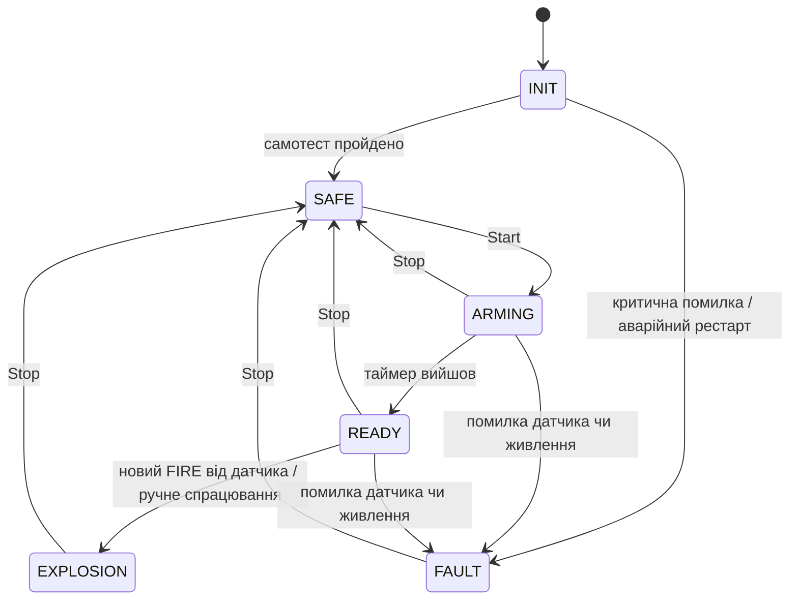

# Ініціатор підриву (безпечна симуляція)

Навчальний проєкт на двох платах LilyGO TTGO T3 (ESP32 LoRa, PlatformIO + Arduino): модель ініціатора
підриву з fail-safe логікою на state machine та імітатор датчика спрацювання.
Реального підривача чи піротехнічних компонентів немає: «спрацювання» це лише червоний світлодіод.

## 1. Завдання

Розробити програмну модель ініціатора ініціатора підриву з State Machine та fail-safe логікою.

Вимоги:

- ініціалізація та максимальна самоперевірка: файлова система, ID чіпа, кнопки, налаштування, доступні компоненти;
- стани Safe, Arm, Ready та імітація спрацювання;
- датчик передає дані через PWM (шпаруватість несе інформацію);
- проста вебсторінка з командами Start, Stop і Fire;
- після Start запускається таймер безпеки (5 хв у бойовому режимі, 5 с для розробки), після нього система переходить у Ready;
- у Ready: Stop повертає в Safe, спрацювання запускає безпечну імітацію;
- абстракція датчиків у коді;
- LED-індикація станів;
- fail-safe поведінка при некоректних даних і помилках;
- додатково: фізичні кнопки та моніторинг напруги живлення.

Проєкт складається з двох прошивок:

| Плата | Прошивка | Роль |
|---|---|---|
| Ініціатор | `trigger` | автомат, дисплей, LED, кнопки, веб, журнал, самотест |
| Імітатор датчика | `sensor` | PWM-сигнал, кнопка "детонація", режими відмов для перевірки fail-safe |

Головна вимога до архітектури: код, який не допускає хибних спрацювань.

## 2. Апаратна частина

### Ініціатор (`trigger`)

| Функція | Пін | Примітка |
|---|---|---|
| Кнопка зелена (Stop, зняти з Arm) | GPIO34 | зовнішня підтяжка до 3V3, активний LOW |
| Кнопка жовта (Start, поставити на Arm) | GPIO14 | активний LOW |
| Червоний LED (спрацювання) | GPIO0 | активний LOW: 3V3 → R → LED → GPIO0 |
| Жовтий LED (ARMING / READY / FAULT) | GPIO2 | активний LOW: 3V3 → R → LED → GPIO2 |
| Вхід PWM, канал A | GPIO13 | пряма шпаруватість |
| Вхід PWM, канал B | GPIO15 | інверсна шпаруватість |
| Вимірювання напруги шини 5 В (імітація напруги акумулятора)| GPIO35 | дільник 2×150 кОм (коефіцієнт 2.0, просто такі резистори були під рукою), рекомендовано додати 100 нФ до GND |
| OLED SSD1306 | GPIO21 (SDA), GPIO22 (SCL) | вбудований |

### Імітатор датчика (`sensor`)

| Функція | Пін | Примітка |
|---|---|---|
| Кнопка red | GPIO34 | зовнішня підтяжка до 3V3, активний LOW |
| Вихід PWM, канал A | GPIO13 | |
| Вихід PWM, канал B | GPIO15 | інверсний |
| LED | GPIO14 | GPIO14 → LED → R → GND (активний HIGH) |
| OLED | GPIO21 / GPIO22 | зображення повернуте на 180° (плата на макетці догори дригом) |

### З'єднання між платами

```
sensor GPIO13 ──► trigger GPIO13   (канал A)
sensor GPIO15 ──► trigger GPIO15   (канал B, інверсний)
sensor GND    ──► trigger GND      (спільна земля обов'язкова)
```

Увага до пінів ESP32:

- GPIO34 та GPIO35 лише входи й не мають внутрішньої підтяжки, тому підтяжка зовнішня.
- GPIO0, GPIO2, GPIO15 strapping-піни (впливають на режим завантаження). Світлодіоди ввімкнені так, щоб при старті вони не тягнули ці піни вниз. GPIO15 лише глушить службовий лог ROM.
- 4.38 В (шина) не можна подавати на GPIO35 напряму (макс. 3.3 В), лише через дільник.

## 3. Архітектура проєкту

```
platformio.ini            env: trigger, trigger_prod (5 хв), sensor, native (юніт-тести)
lib/common/pwm_protocol.h спільний протокол сенсор → ініціатор
data/index.html           веб-сторінка (LittleFS ініціатора)
src/trigger/              прошивка ініціатора
src/sensor/main.cpp       прошивка імітатора датчика
test/test_fsm/            юніт-тести автомата на хості
```

### Модулі ініціатора (`src/trigger`)

| Модуль | Призначення |
|---|---|
| `trigger_fsm` | автомат: стани, таблиця переходів, guard-и, команди, тест-режим |
| `sensor_iface.h` | абстракція `ISensor`: автомат знає лише статус NORMAL/FIRE/FAULT/UNKNOWN |
| `pwm_channel` | один PWM-канал: вимірювання періоду і шпаруватості в перериванні, фільтр глітчів |
| `dual_sensor` | об'єднує два канали в один датчик, порівнює їх |
| `power_iface.h`, `vbus_monitor` | абстракція і реалізація моніторингу напруги |
| `buttons` | дві кнопки з дебаунсом, ігнорування одночасного натискання |
| `indicators` | червоний і жовтий LED, OLED |
| `selftest` | самоперевірка при старті |
| `event_log` | кільцевий журнал подій у NVS з CRC |
| `web_ui` | WiFi-клієнт, веб-сервер, API, mDNS |
| `config.h`, `wifi_secrets.h` | константи (піни, таймінги) та облікові дані WiFi |

Автомат залежить лише від інтерфейсів (`ISensor`, `IVoltageMonitor`, `IEventSink`) і не знає про Arduino. Тому він
компілюється на ПК і покритий юніт-тестами.

### Автомат станів



| Стан | Червоний LED | Жовтий LED |
|---|---|---|
| SAFE | вимкнений | вимкнений |
| ARMING | вимкнений | повільно блимає (1 Гц) |
| READY | вимкнений | світить постійно |
| READY, FIRE був до постановки | вимкнений | світить із короткими «смиканнями» |
| EXPLOSION | світить постійно | вимкнений |
| FAULT | вимкнений | швидко блимає |
| Тест-режим, SAFE | вимкнений | короткий імпульс раз на секунду |
| Тест-режим, EXPLOSION | вимкнений | подвійний спалах раз на секунду |

### PWM-протокол датчика

Датчик передає стан двома лініями, частота 1 кГц (допуск періоду ±10%, допуск шпаруватості ±8 в.п.):

| Стан | Канал A | Канал B (інверсний) |
|---|---|---|
| NORMAL | 25% | 75% |
| FIRE | 75% | 25% |
| все інше | FAULT | FAULT |

Обрив, КЗ, чужа частота, шпаруватість поза вікнами, відсутність фронтів довше 250 мс: усе це FAULT, ніколи не FIRE.

## 4. Використані рішення

- **Єдиний вхід у зміну стану.** Стан змінюється тільки функцією `transition()`: вона перевіряє таблицю дозволених
  переходів і arm-умови в момент переходу, незалежно від того, хто його запросив.
- **Захист змінної стану.** Стан зберігається разом з інвертованою копією. Якщо вони розійшлися (пошкодження пам'яті),
  автомат переходить у FAULT.
- **Абстракція датчика.** Автомат працює з `ISensor`. Реальний PWM-датчик, двоканальний варіант або тестова заглушка
  підміняються без змін автомата.
- **Двоканальне порівняння.** `DualSensor` видає NORMAL або FIRE тільки коли обидва канали збігаються.
  Інверсія каналу B виявляє залипання, обрив однієї лінії та замикання ліній між собою.
- **Фронт сигналу.** Спрацювання можливе лише по сигналу, що почався вже після переходу в READY. FIRE, який тримався
  в момент постановки, ігнорується, доки не зникне, а оператор отримує попередження.
- **Двокроковий ручний підрив.** Команда «Підрив» з вебу потребує двох викликів у вікні 5 с, перевірка робиться на
  сервері. З фізичних кнопок гасіння недоступне.
- **Тест-режим.** Весь ланцюг відпрацьовує, але вихід спрацювання (червоний LED) не вмикається.
- **Журнал подій у NVS.** Кільцевий буфер на 32 записи з CRC. Запис у флеш відкладений і ніколи не відбувається
  під час ARMING/READY, щоб не затримати спрацювання.
- **Прискорений I2C для OLED** (400 кГц), інакше перемальовування екрана блокувало б цикл приблизно на 100 мс.
- **Два watchdog-и:** task WDT (5 с) і незалежний RTC WDT (8 с). Годуються в кінці циклу.
- **Юніт-тести автомата** запускаються на хості без плати.

## 5. Що дає системі надійність

| Загроза | Захист |
|---|---|
| Хибне спрацювання від шуму чи глітча | фільтр 50 мс і валідація кожного PWM-кадра за частотою та шпаруватістю |
| Обрив, КЗ, мертвий датчик | таймаут 250 мс без фронтів, FAULT |
| Залипання або обрив однієї лінії | двоканальне порівняння, розбіжність довше 100 мс дає FAULT |
| Сигнал був ще до постановки | спрацювання тільки по новому фронту після READY, попередження оператору |
| Спрацювання одразу після постановки | блокування 0.5 с після входу в READY |
| Спрацювання з неправильного стану | таблиця переходів і guard-и, недозволений перехід веде у FAULT |
| Пошкодження змінної стану | інвертована копія, розбіжність веде у FAULT |
| Просадка або завищена напруга живлення | моніторинг 4.0–5.6 В, вихід за межі дає FAULT і забороняє Start |
| Залипла кнопка або натискання двох кнопок | самотест при старті, ігнорування комбінації |
| Випадковий підрив з вебу | тільки з READY, двокроково, з таймаутом |
| Зависання програми | task WDT (5 с) і RTC WDT (8 с) |
| Аварійне перезавантаження (WDT, паніка, brownout) | старт у FAULT до підтвердження кнопкою Stop |
| Критична помилка самотесту | старт у FAULT, Start заборонений |
| Розбір інцидентів | журнал подій у NVS, переживає перезавантаження |

Принцип: **будь-яка невизначеність веде в безпечний стан без спрацювання**. Вихід із FAULT і EXPLOSION лише ручною
командою Stop.

Самотест при старті перевіряє: ID чіпа, LittleFS і наявність `index.html`, NVS (запис і читання лічильника завантажень),
відсутність натиснутих кнопок, наявність OLED, а далі стан датчика й напругу живлення.

## 6. Як користуватися

### Збірка та прошивка

Потрібен PlatformIO (`pio`). Порти своїх плат дізнайтесь командою `pio device list`.

```bash
# ініціатор: прошивка + файлова система (index.html) — обидва кроки обов'язкові
pio run -e trigger -t upload   --upload-port <порт ініціатора>
pio run -e trigger -t uploadfs --upload-port <порт ініціатора>

# імітатор датчика
pio run -e sensor -t upload --upload-port <порт сенсора>

# бойовий режим: затримка постановки 5 хв замість 5 с
pio run -e trigger_prod -t upload --upload-port <порт ініціатора>

# юніт-тести автомата на ПК
pio test -e native
```

Перед першою прошивкою впишіть свою мережу у `src/trigger/wifi_secrets.h` (WiFi 2.4 ГГц).
Файл містить пароль, тому не додавайте його в публічний репозиторій.

Спостерігати лог: `pio device monitor --port <порт> -b 115200`.

### Робота з ініціатором

1. Увімкніть живлення. Самотест виконується при старті, результат у Serial і на OLED. Якщо WiFi підключився,
   IP показується в нижньому рядку OLED.
2. **Жовта кнопка** (Start): ARMING, жовтий LED блимає, відлік на OLED. Після таймера READY, жовтий світить постійно.
3. **Зелена кнопка** (Stop): повернення в SAFE з будь-якого стану, у тому числі з FAULT і EXPLOSION.
4. У READY натисніть **red** на сенсорі: через 50 мс фільтра червоний LED вмикається, стан EXPLOSION.
   Скидання зеленою кнопкою.

### Веб-інтерфейс

Відкрийте `http://<IP плати>/` або `http://trigger.local/` з пристрою в тій самій мережі.
Використовуйте саме `http://`, шифрування (HTTPS) не підтримується.

Сторінка показує стан, таймер, статус датчика, напругу та причину помилки, а також має кнопки:

- **Start** і **Stop**: так само, як фізичні кнопки;
- **Підрив (симуляція)**: працює лише в READY, просить підтвердження;
- **Тест-режим**: доступний у SAFE, вихід спрацювання вимкнено, показується банер;
- **Тест watchdog**: з'являється тільки в тест-режимі, навмисно зависає плату для перевірки watchdog (після скидання плата стартує у FAULT);
- **Журнал подій**: розділ, що розгортається.

API: `GET /api/status`, `GET /api/log`, `POST /api/cmd` з полем `cmd` (`start`, `stop`, `explosion`, `test`, `wdttest`).

### Імітатор датчика

- **Коротке натискання red**: перемикає NORMAL і FIRE (спрацьовує при відпусканні кнопки).
- **Утримання red довше за 0.7 с**: наступний режим відмови по колу, потім повернення в NORMAL.

| Режим відмови | Що імітує | Очікувана реакція ініціатора |
|---|---|---|
| no signal | обидві лінії LOW | FAULT |
| stuck high | обидві лінії HIGH | FAULT |
| bad freq 500Hz | чужа частота | FAULT |
| bad duty 50% | шпаруватість поза вікнами | FAULT |
| line B dead | обрив лінії B | FAULT |
| line A dead | обрив лінії A | FAULT |
| B not inverted | замкнуті лінії або помилка кабелю | FAULT |
| fire glitches | короткі хибні імпульси FIRE по 20 мс | спрацювання **не** відбувається |

### Рекомендований сценарій перевірки

1. Нормальне спрацювання: Start, дочекатись READY, натиснути red, очікувати червоний LED.
2. Сигнал до постановки: Start, під час відліку увімкнути FIRE і тримати. У READY спрацювання немає, жовтий «смикається», є попередження. Вимкніть і знову ввімкніть FIRE: тепер спрацює.
3. Fail-safe: у READY висмикніть дріт PWM або перемкніть сенсор у режим відмови. Очікуйте FAULT без спрацювання.
4. Хибні імпульси: режим `fire glitches` не має викликати спрацювання.
5. Тест-режим: дійти до EXPLOSION, переконатись, що червоний не світить.

## 7. Обмеження

- Це симуляція: реального виконавчого виходу немає.
- Веб-інтерфейс без авторизації та без HTTPS: будь-який пристрій у мережі може надіслати команду.
  Від випадкового спрацювання захищають двокроковий підрив та логіка автомата.
- Датчик передає лише дискретний стан (норма або підрив), аналогових даних немає.
- Журнал подій обмежений 32 записами.
