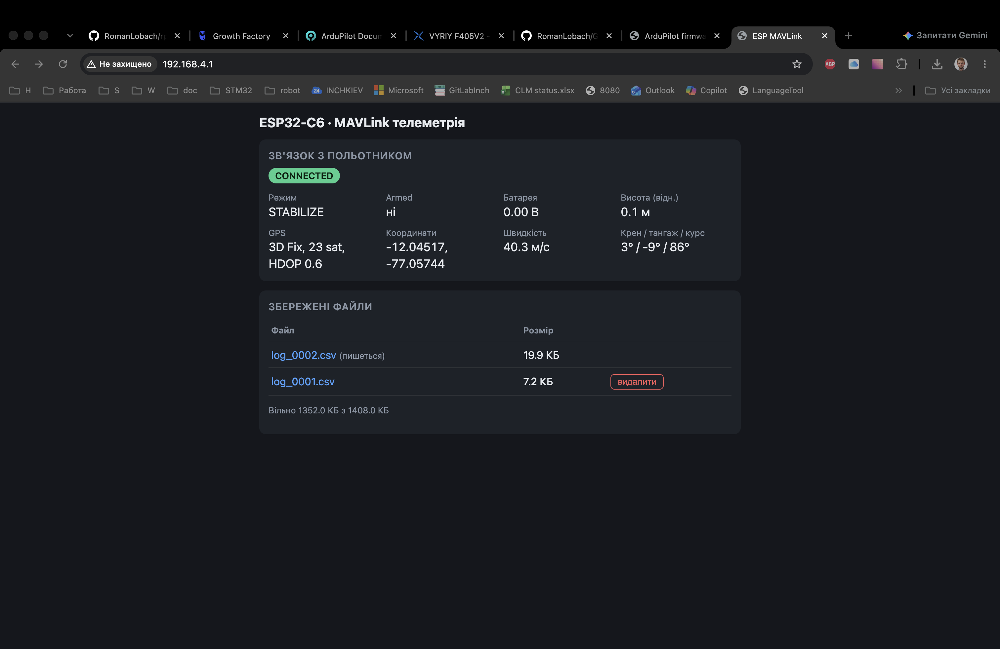

# Підключення ESP до польотного контролера через MAVLink

## Завдання

Підключити ESP до польотного контролера з ArduPilot як companion computer і налаштувати
отримання телеметрії через MAVLink.

**Обов'язково**
- зробити MAVLink-з'єднання між ESP і польотником;
- отримувати основну телеметрію: батарею, висоту, режим польоту, GPS та інше доступне;
- зберігати вибрані параметри у файловій системі ESP;
- перевірити все на власному польотному контролері.

**Додатково**
- вебінтерфейс для перегляду й завантаження збережених файлів через Wi-Fi;
- телеметрія у форматі CSV;
- обробка втрати MAVLink-зв'язку, перезапуску ESP і повторного підключення до польотника.

---

## Рішення

Усе з переліку зроблено, включно з додатковими пунктами. Працює на реальному залізі:
SpeedyBee F405 V3 (клон) з ArduPilot Copter 4.7.2 і ESP32-C6.

ESP слухає польотник по UART, розбирає MAVLink2, раз на секунду дописує рядок у CSV на флеші
і сама піднімає Wi-Fi, через яку можна подивитися телеметрію наживо й забрати файли.

### Підключення

| Польотник | ESP32-C6 |
|---|---|
| T3 (TX UART3) | GPIO7 (RX) |
| R3 (RX UART3) | GPIO6 (TX) |
| G | GND |

ESP живиться від USB, 5 V з польотника не підключаємо. Піни змінюються в `platformio.ini`
(`-DMAV_RX_PIN`, `-DMAV_TX_PIN`). Фото підключення: [doc/img/physical_level.JPG](doc/img/physical_level.JPG).

### Налаштування польотника

На польотнику має бути ArduPilot. Порт під ESP налаштовується в QGroundControl:

| Параметр | Значення |
|---|---|
| `SERIAL3_PROTOCOL` | 2 (MAVLink2) |
| `SERIAL3_BAUD` | 115200 |

Після зміни польотник треба перезавантажити.

### Як влаштований код

| Файл | Що робить |
|---|---|
| `src/mav_link.cpp` | окрема задача FreeRTOS: читає UART, ловить heartbeat автопілота, шле свій heartbeat і просить потрібні повідомлення (`SET_MESSAGE_INTERVAL`), стежить за станом зв'язку |
| `src/telemetry.cpp` | зберігає останній стан, переводить режим польоту в назву, формує рядок CSV і JSON |
| `src/storage.cpp` | CSV на LittleFS: нумерація файлів, ротація, чистка старих при нестачі місця |
| `src/web.cpp` | Wi-Fi точка доступу, сторінка, список файлів, завантаження, видалення |
| `src/main.cpp` | склеює все: відкриває файл, коли є зв'язок, пише рядок раз на секунду |

Що збирається з польотника: режим польоту й armed (HEARTBEAT), напруга/струм/відсоток батареї
(SYS_STATUS), висота й координати (GLOBAL_POSITION_INT), тип фіксу, супутники, HDOP (GPS_RAW_INT),
швидкість і газ (VFR_HUD), крен/тангаж/курс (ATTITUDE).

### Втрата зв'язку та перезапуски

| Що сталося | Що робить ESP |
|---|---|
| 3 секунди немає heartbeat | стан `LOST`, поточний CSV закривається |
| heartbeat повернувся | `CONNECTED`, знову просить потоки, відкриває новий CSV |
| перезапустили польотник | те саме: `LOST`, потім `CONNECTED` і новий файл |
| перезапустили ESP | файли на місці, нумерація продовжується (`log_0003`, `log_0004`, ...) |

Дані старші за 5 секунд вважаються застарілими, у CSV на їх місці порожня клітинка. Новий файл
починається лише коли вже прийшли свіжі дані, тож порожніх рядків на початку немає.

### Вебінтерфейс

Підключитися до Wi-Fi **`ESP-MAVLink`** (пароль `mavlink123`) і відкрити **http://192.168.4.1/**.
На сторінці: статус зв'язку, режим, батарея, висота, GPS, координати, швидкість, орієнтація,
а також список файлів із завантаженням і видаленням (файл, що пишеться зараз, видалити не можна).



### CSV

Один рядок на секунду. Колонки:

`ms, mode, armed, batt_v, batt_a, batt_pct, alt_rel_m, alt_msl_m, lat, lon, fix, sats, hdop,
gs_ms, climb_ms, roll_deg, pitch_deg, yaw_deg, throttle_pct`

Приклад (`doc/log_0008.csv`, GPS ще без фіксу, акумулятора немає, тому порожньо в токах і відсотках):

```csv
ms,mode,armed,batt_v,batt_a,batt_pct,alt_rel_m,alt_msl_m,lat,lon,fix,sats,hdop,gs_ms,climb_ms,roll_deg,pitch_deg,yaw_deg,throttle_pct
4218,STABILIZE,0,0.00,,,-0.06,0.09,0.0000000,0.0000000,1,0,99.99,0.04,-0.01,0.7,-2.8,-35.5,0
```

### Збірка і прошивка

```bash
pio run
pio run -t upload --upload-port /dev/cu.usbmodemXXXX
```

Перед прошивкою закрити QGroundControl: він сам захоплює USB-порти і не пускає в порт ESP.

---

## Що перевірено

| Перевірка | Результат | Матеріали |
|---|---|---|
| MAVLink-зв'язок, телеметрія | `CONNECTED`, режим `STABILIZE`, GPS 3D Fix 20+ супутників | [web_screen.png](doc/img/web_screen.png) |
| Збереження в CSV | файли `log_NNNN.csv` на флеші ESP | [doc/log_0001.csv](doc/log_0001.csv), [doc/log_0008.csv](doc/log_0008.csv) |
| Вебінтерфейс | телеметрія наживо, список, завантаження файлів | [web_screen.png](doc/img/web_screen.png) |
| Обрив UART | `LOST`, потім автоматичне відновлення і новий файл | [uart_loss.mp4](doc/video/uart_loss.mp4) |
| Перезапуск польотника | `LOST`, потім `CONNECTED` | [fc_loss.mp4](doc/video/fc_loss.mp4) |
| Перезапуск ESP | файли збережені, нумерація продовжилась | [esp_loss.mp4](doc/video/esp_loss.mp4) |

## Нюанси

- **Батарея.** Акумулятор не підключений, тому напруга 0.00 В, а струм і відсотки порожні.
- **GPS.** У `log_0008.csv` приймач ще без фіксу (`fix=1`, 0 супутників), у `log_0001.csv` уже 3D Fix.
  ESP лише передає те, що повідомляє польотник.
- **QGroundControl** сам захоплює USB-порти, тому на час прошивки й моніторингу ESP його треба закрити.
